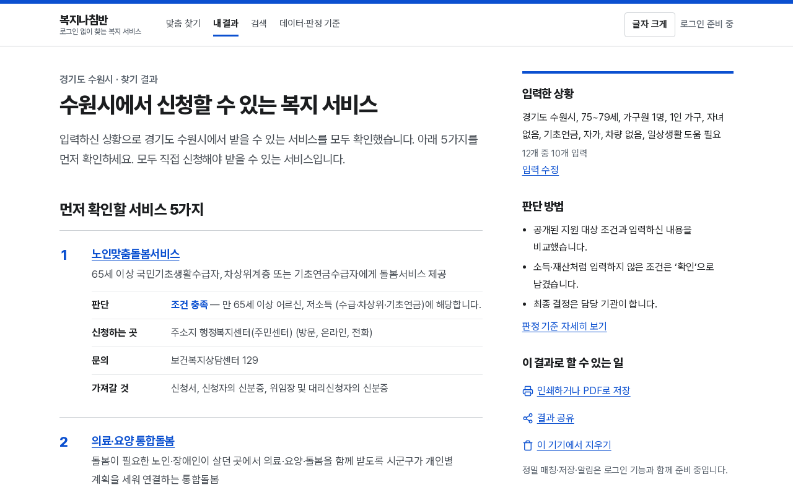

# 복지나침반 (MVP)

로그인 없이 12개 간단한 질문으로 **중앙정부·청 / 시도 / 시군구 / 공공기관** 복지 서비스를 찾아
**조건 충족 · 가능성 있음 · 확인 필요** 3단계로, 이유와 함께 보여주는 서비스입니다.
입력값은 서버로 보내지 않고 브라우저 안에서 판정합니다. (기획: `/workspace/welfare-plan/기획안.md`, `설계서.md` v0.3)



## 빠르게 실행

```bash
npm install
npm run build          # 프로덕션 빌드 (번들은 public/bundles/v1 에 커밋되어 있어 바로 빌드 가능)
npm start              # http://localhost:3000  (포트 변경: npx next start -p 3217)
npm run dev            # 개발 서버
```

| 명령 | 내용 |
|---|---|
| `npm run lint` | ESLint (flat config) |
| `npm run typecheck` | `next typegen` + `tsc --noEmit` |
| `npm test` | Vitest 단위 테스트 (엔진·정규화·규칙 변환·병합·결과 계산) |
| `npm run e2e` | Playwright e2e — 헤드리스 Chromium, `next start` 를 스스로 띄움(포트 3218). 이미 떠 있는 서버를 쓰려면 `E2E_BASE_URL=http://localhost:3217 npm run e2e` |
| `npm run pipeline` | 데이터 파이프라인 → `public/bundles/v1/*`, `pipeline/out/*` 재생성 (~3초) |
| `npm run ingest:gov24` | 공공서비스(혜택) API 수집 (키 필요, 캐시 사용) |
| `npx tsx scripts/shots.ts http://localhost:3217` | 데모 스크린샷 → `shots/` |

## 화면 흐름 (로그인 없음)

1. **홈** `/` — 시작 버튼, 키워드 검색, 3단계 설명, 데이터 규모. 로그인은 비활성 `🔒 로그인 준비 중` 버튼만.
2. **입력** `/check` — 5단계 12개 항목(거주지만 필수, 나머지는 모두 `모름/건너뛰기`). 장애·돌봄은 선택 입력.
   이 기기(localStorage)에만 저장, `공용 기기 모드`(sessionStorage), `이 기기에서 지우기`.
3. **결과** `/results` — 3단계 탭 + 기관 유형·분야 필터 + 결과 내 검색. 개수는 서로의 필터를 반영해 함께 갱신.
   카드마다 한 줄 근거, `조건이 맞지 않는 서비스 N개도 보기`, 인쇄·PDF, 공유(요약만, 입력값 미포함),
   `🔒 정밀 매칭/저장·알림 (준비 중)`.
4. **상세** `/p/[id]` — 판정 근거(✓/✕/?/참고), 규칙 검수 상태와 근거 구절, 서비스 내용, 우리 지역 운영 정보(통합돌봄),
   소관/집행기관, 신청처·연락처 또는 **주민센터·시군구청·☎129/110 대체 안내**, 공식 원문 링크(없으면 복지로 검색 안내),
   출처별 **원문 기준일·수집일**, 신뢰도. `🔒 신청 준비/알림 (준비 중)`.
5. **검색** `/search`, **데이터·판정 기준** `/about`. 헤더의 `가+ 큰 글씨`는 125% 확대(설정은 기기에 저장).

## 구조

```
pipeline/                 데이터 파이프라인 (TypeScript, tsx 실행)
  src/gov24/ingest.ts     공공서비스(혜택) API 수집: serviceList / supportConditions / serviceDetail
                          perPage=1000 페이지 단위, raw 캐시(pipeline/raw/, gitignore), 일일 예산(_budget.json)
  src/sources/*.ts        원천별 어댑터 → SourceRecord (gov24 · 복지로 색인 · 복지 100선 · 통합돌봄 메뉴판)
  src/normalize/*.ts      행정구역(2026-07 코드표, 전남광주통합특별시·인천 개편 반영), 분야 15종, 이름 정규화
  src/rules/*.ts          규칙 변환: supportConditions(JA코드) / 복지로 태그 / 대상 문구 → 3값 논리 규칙
  src/dedup.ts            원천 내 중복(D1·D2) + 교차 원천 병합(이름키·기관 단계·지역 대조)
  src/build.ts            번들·리포트 생성, 검수 원장 적용
  rules/curated.ts        원문 대조 큐레이션 규칙 (전국 62 + 경기 10 + 기타)
  rules/review-ledger.csv 사람 검수 원장 (verified/rejected, 검수자·일자)
  out/                    report.md·json, review-queue-gyeonggi.csv(검수 대기열), review-curated.csv
public/bundles/v1/        national.json · sido/{코드}.json · sigungu/{코드}.json · regions.json · meta.json
src/lib/engine/           규칙 엔진 (profile 12항목, 3값 논리 T/F/U, 3단계 판정 + 한국어 이유)
src/lib/client/           기기 저장소(useSyncExternalStore), 번들 로더, 결과 계산·면 필터
src/app/                  Next.js 16 App Router 화면
tests/unit, pipeline/tests  Vitest   ·   tests/e2e  Playwright
```

**개인정보 흐름**: 브라우저는 `national.json` + 내 `sido` + 내 `sigungu` 번들(정적 파일, GET)만 받습니다. 프로필은 어떤 요청에도
실리지 않습니다(e2e 에서 모든 요청을 검사). 서버 API·DB·로그인 없음 → Vercel 정적/Edge 배포와 호환(`/p/[id]` 만 on-demand 렌더).
※ 번들 경로로 **시군구 단위 지역**은 정적 파일 요청에 드러납니다(설계상 허용, 아래 결정 사항 참고).

### 판정 정책 (설계서 6.1·6.2)
- 규칙은 조건 트리(all/any) + 3값 논리. `모름`은 U(미확정), 묻지 않는 조건(재산·질병 등)은 항상 U.
- **검수 규칙**(verified / curated): 모두 T → `조건 충족`, U 남음 → `가능성 있음`.
- **자동 변환 규칙**(auto): 충족 조건이 있으면 최대 `가능성 있음`, 없으면 `확인 필요`.
- 비정형 핵심 조건(‘필요하다고 인정되는 자’ 등) 또는 규칙 없음 → `확인 필요`. 하나라도 F → `조건 불일치`(기본 숨김).
- 정렬: 검수 규칙 → 충족 조건 수 → 시군구·시도·전국 순.

### 규칙 검수 흐름
1. `npm run pipeline` → `pipeline/out/review-queue-gyeonggi.csv`(경기 자동 규칙), `review-curated.csv`(큐레이션 규칙).
2. 검수자가 원문과 대조 후 `pipeline/rules/review-ledger.csv` 에 `rule_id 또는 curated:<키>, verified|rejected, 검수자, 일자, 메모` 기록.
3. 재빌드하면 verified 는 `검수 규칙`(조건 충족 판정 가능), rejected 는 규칙 제거(확인 필요).
현재 큐레이션 규칙 73개는 **원문 근거 구절과 대조해 AI가 1차 작성**한 것으로, UI에 `검수 규칙(1차)`와 “최종 사람 검수 진행 중”을 표시합니다.

## 데이터: 실제 vs 대기

| 원천 | 상태 | 건수 | 비고 |
|---|---|---|---|
| 복지로 복지서비스 색인 (`/workspace/icdash/data/w100_index-lite/extra.json`, 선행 대시보드 수집본, 기준 2026-09-24) | ✅ 사용 | 5,204 | WLF ID·복지로 링크·분류 태그. 신청방법·연락처 없음 |
| 통합돌봄 지방정부 서비스 메뉴판 (`/workspace/icdash/policies.csv`) | ✅ 사용 | 12,526행 | 원문 기준월별, 신청방법·연락처 대부분 비어 있음 |
| 복지 100선 요약 (같은 색인의 큐레이션 100건) | ✅ 사용 | 100 | 이전 대시보드의 요약문(2차), 원문 URL 없음 |
| 공공서비스(혜택) API (data.go.kr 15113968) | ⏳ 대기 | 0 | 수집기 완성. 현재 키가 **HTTP 401 `code -4` “등록되지 않은 인증키”** 로 거부됨 |
| 복지로 OpenAPI (B554287) | ⏳ 대기 | 0 | HTTP 403 `SERVICE_KEY_IS_NOT_REGISTERED_ERROR` |

병합 후 **16,300개** 사업(중앙 482 · 시도 948 · 시군구 13,808 · 공공기관 1,062). 상세 수치는 `pipeline/out/report.md`.
모든 프로그램 데이터는 위 원천에서만 가져오며 임의로 만든 사업은 없습니다.

### 공공서비스 API 키가 승인되면
```bash
export DATA_GO_KR_SERVICE_KEY=...   # 또는 .env.local 에 두고: npx tsx --env-file=.env.local pipeline/src/gov24/ingest.ts
npm run ingest:gov24                # 약 30~40회 호출, 응답은 pipeline/raw/gov24/ 에 캐시 (재실행 시 재호출 안 함)
npm run pipeline && npm run build
```
gov24 가 들어오면 병합 우선순위는 gov24 > 복지로 > 100선 > 통합돌봄이며, supportConditions(JA 코드)가 구조화 규칙으로 변환됩니다
(교육청·공공기관 서비스 포함, 사용자구분 ‘개인/가구’만 노출).

## 환경 변수

| 이름 | 용도 | 필요 시점 |
|---|---|---|
| `DATA_GO_KR_SERVICE_KEY` | 공공데이터포털 일반 인증키 (헤더 `Authorization: Infuser …`로만 전송, 로그·커밋 금지) | 파이프라인 수집 시만 |
| `GOV24_DAILY_BUDGET` | 일일 호출 예산 (기본 2000) | 선택 |
| `E2E_BASE_URL` / `E2E_PORT` | e2e 대상 서버 | 선택 |

앱 런타임에는 환경 변수가 필요 없습니다. `.env.example` 참고.

## 배포 (Vercel, 아직 배포하지 않음)
- 프레임워크 기본값(Next.js) 그대로. 번들(약 20MB, 시군구 번들 gzip 평균 ~12KB)은 `public/` 정적 자산으로 함께 배포.
- 데이터 갱신 = `npm run pipeline` 후 커밋 → 재배포.
